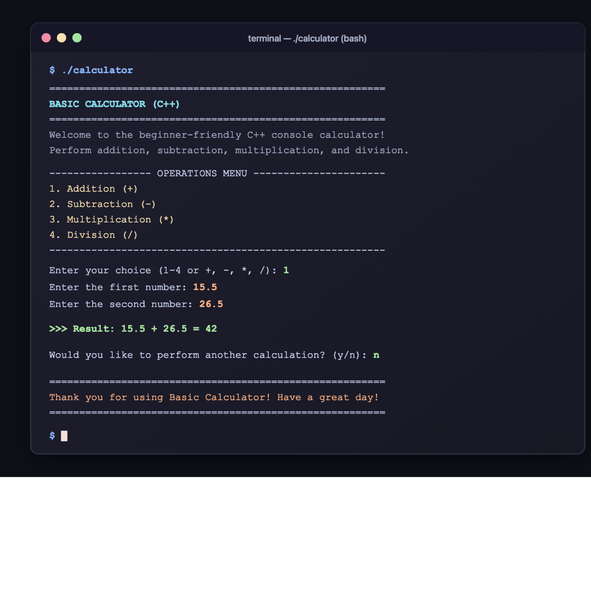

# Basic Calculator (C++)


A clean, beginner-friendly console calculator application written in C++. This project demonstrates fundamental programming principles such as modular functions, input validation, switch-free conditional control flow using `if-else` statements, continuous calculation loops, and robust division-by-zero protection.

> **Note**: This is an introductory, beginner-level C++ project designed to showcase readable, clean, and reliable procedural code without overcomplicating simple concepts.

---

## 📸 Application Screenshot



---

## 🌟 Features

- **Four Core Arithmetic Operations**:
  - ➕ Addition (`+` or `1`)
  - ➖ Subtraction (`-` or `2`)
  - ✖️ Multiplication (`*` or `3`)
  - ➗ Division (`/` or `4`)
- **Dual Selection Support**: Accept both numeric menu choices (`1`, `2`, `3`, `4`) and mathematical operator symbols (`+`, `-`, `*`, `/`).
- **Full Numeric Support**: Computes integers, floating-point decimal numbers, and negative numbers.
- **Division-by-Zero Guard**: Prevents undefined mathematical operations and safely alerts the user without crashing.
- **Robust Input Validation**: Recovers gracefully from non-numeric input (e.g. typing characters or words when expecting numbers) and invalid menu choices.
- **Repetition Loop**: Allows multiple consecutive calculations in a single session.
- **Graceful Termination**: Welcomes the user on startup and bids farewell upon user exit.

---

## 🛠 Technologies Used

- **Language**: C++ (Compatible with C++11, C++14, C++17, and C++20)
- **Standard Libraries**:
  - `<iostream>`: Standard console input and output streaming.
  - `<limits>`: Stream limits for clearing the input buffer during error recovery.
  - `<string>`: Text and prompt handling.
- **Compilers Supported**:
  - GCC / G++ (`g++`)
  - Clang / LLVM (`clang++`)
  - Microsoft Visual C++ (`MSVC` / `cl.exe`)
- **Platform**: Cross-platform (macOS, Linux, Windows)

---

## 🧠 C++ Concepts Demonstrated

1. **Modular Functions**:
   - Distinct functions (`add`, `subtract`, `multiply`, `divide`) adhering to the Single Responsibility Principle.
   - Reusable UI helper functions (`displayWelcomeMessage`, `displayMenu`, `getValidNumber`, `clearInputBuffer`).
2. **Conditional Control Flow (`if-else`)**:
   - Switch-free implementation utilizing structured `if-else if-else` logic for operation dispatching and error handling.
3. **Loop Structures**:
   - `do-while` loop enabling repetitive calculations until the user chooses to exit.
   - `while` loops for input validation and interactive re-prompting.
4. **Standard Stream Input & Validation**:
   - Detection of stream failure states with `std::cin.fail()`.
   - Clearing error flags (`std::cin.clear()`) and discarding invalid input tokens (`std::cin.ignore()`).
5. **Floating-Point Arithmetic**:
   - `double` precision data types for seamless calculation with decimals and negatives.

---

## 📂 Project Folder Structure

```text
Basic-Calculator-CPP/
├── .gitignore          # Git ignore rules for binaries and system files
├── LICENSE             # MIT License
├── main.cpp            # Complete C++ source code
├── README.md           # Project documentation and guide
└── screenshots/        # Terminal execution demonstrations
    ├── demo.png        # High-resolution application preview
    └── demo.svg        # Scalable vector graphic representation
```

---

## 🚀 Installation & Prerequisites

To build and run this project locally, ensure you have a modern C++ compiler installed:

- **macOS**: Install Xcode Command Line Tools:
  ```bash
  xcode-select --install
  ```
- **Linux (Ubuntu/Debian)**:
  ```bash
  sudo apt update && sudo apt install build-essential
  ```
- **Windows**: Install [MinGW-w64](https://www.mingw-w64.org/) or [Visual Studio Community](https://visualstudio.microsoft.com/).

---

## 🔨 Compilation Instructions

Clone the repository and compile using your preferred C++ compiler:

### Using G++
```bash
git clone https://github.com/samdavi-gyanbridge/Basic-Calculator-CPP.git
cd Basic-Calculator-CPP
g++ -Wall -Wextra -pedantic -std=c++11 main.cpp -o calculator
```

### Using Clang++
```bash
clang++ -Wall -Wextra -pedantic -std=c++11 main.cpp -o calculator
```

### Using MSVC (Windows Developer Command Prompt)
```cmd
cl /EHsc /W4 main.cpp /Fe:calculator.exe
```

---

## ▶️ Execution Instructions

Run the compiled executable directly from your terminal:

### On macOS / Linux:
```bash
./calculator
```

### On Windows:
```cmd
calculator.exe
```

---

## 🖥 Sample Output

### 1. Normal Calculation (Addition)
```text
========================================================
               BASIC CALCULATOR (C++)                   
========================================================
Welcome to the beginner-friendly C++ console calculator!
Perform addition, subtraction, multiplication, and division.

----------------- OPERATIONS MENU ----------------------
  1. Addition       (+)
  2. Subtraction    (-)
  3. Multiplication (*)
  4. Division       (/)
--------------------------------------------------------
Enter your choice (1-4 or +, -, *, /): 1
Enter the first number:  15.5
Enter the second number: 26.5

>>> Result: 15.5 + 26.5 = 42

Would you like to perform another calculation? (y/n): n

========================================================
  Thank you for using Basic Calculator! Have a great day!
========================================================
```

### 2. Division by Zero Protection
```text
----------------- OPERATIONS MENU ----------------------
  1. Addition       (+)
  2. Subtraction    (-)
  3. Multiplication (*)
  4. Division       (/)
--------------------------------------------------------
Enter your choice (1-4 or +, -, *, /): /
Enter the first number:  50
Enter the second number: 0

[Error] Cannot divide by zero! Division by zero is undefined in mathematics.

Would you like to perform another calculation? (y/n): n
```

### 3. Invalid Input Recovery
```text
----------------- OPERATIONS MENU ----------------------
  1. Addition       (+)
  2. Subtraction    (-)
  3. Multiplication (*)
  4. Division       (/)
--------------------------------------------------------
Enter your choice (1-4 or +, -, *, /): 1
Enter the first number:  hello
  [!] Invalid numerical input. Please enter a valid number.
Enter the first number:  42
Enter the second number: 8

>>> Result: 42 + 8 = 50
```

---

## 🔮 Future Improvements

While this project is intentionally kept beginner-friendly, potential future enhancements could include:
- Advanced scientific operations (exponents, square root, trigonometric functions).
- Mathematical expression parsing (e.g., evaluating `3 + 5 * 2` respecting operator precedence).
- Calculation history logging to a text file.
- Memory store/recall features (`M+`, `M-`, `MR`).
- Graphical User Interface (GUI) using Qt or wxWidgets.

---

## 📄 License

This project is open-source and available under the [MIT License](LICENSE).
